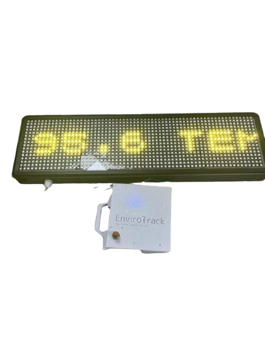
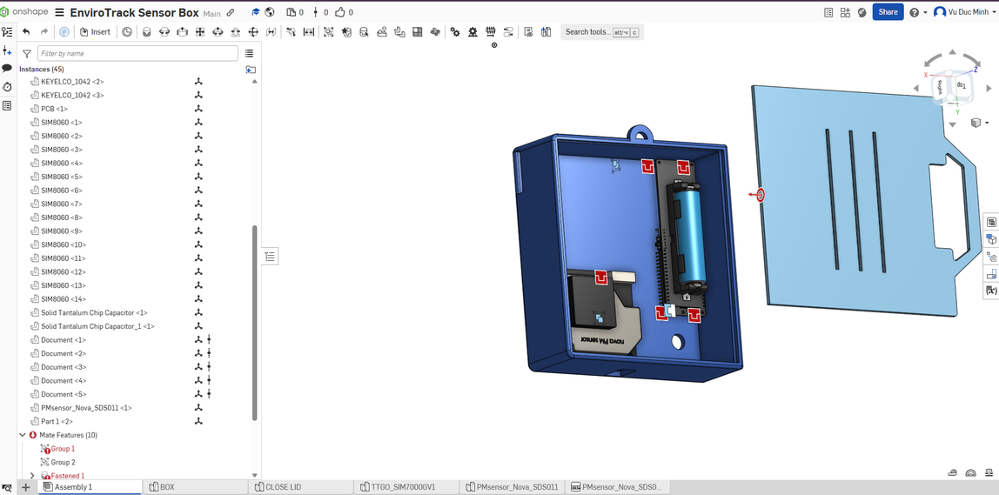
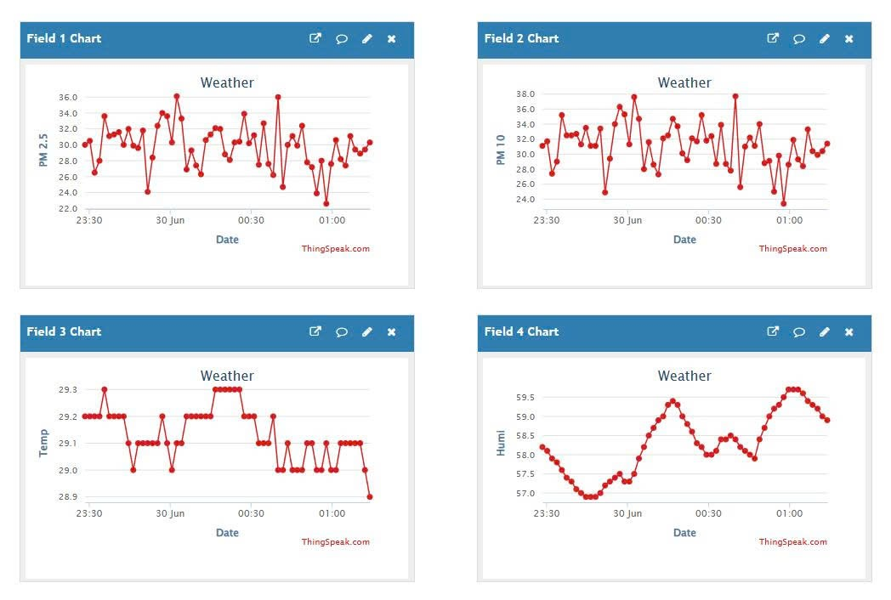
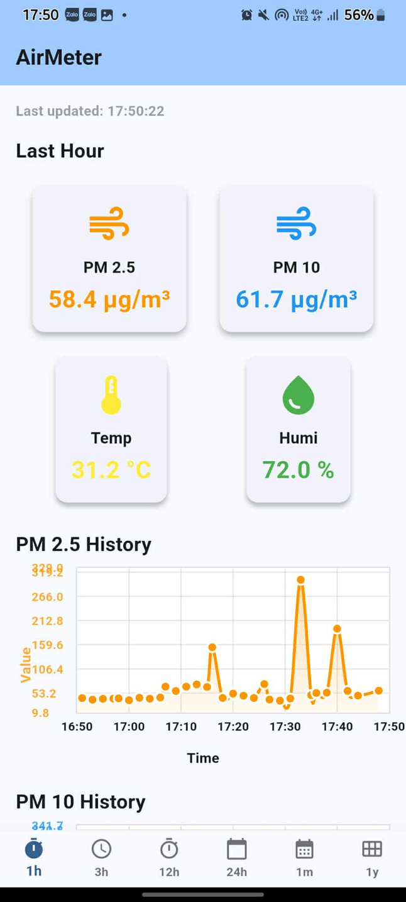
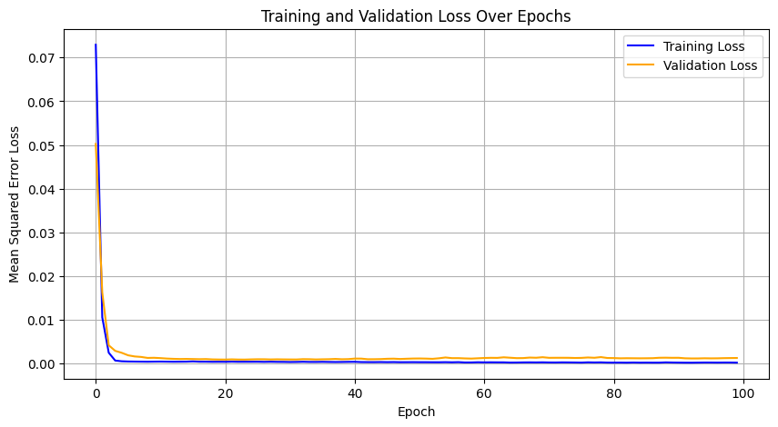
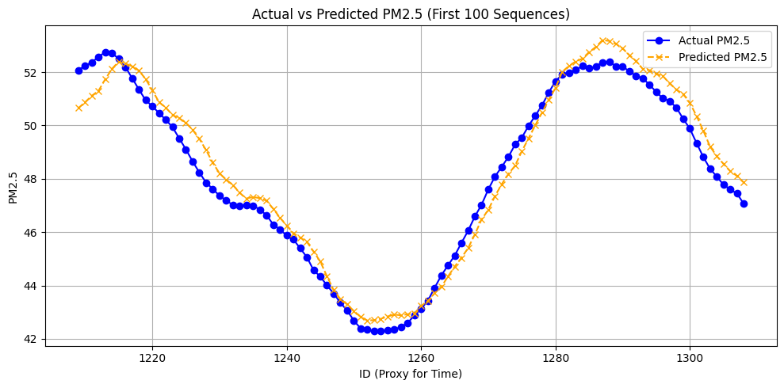

# EnviroTrack

**IoT air quality monitoring and forecasting system for urban areas**

EnviroTrack is a low-cost, solar-powered air quality station built on an ESP32 with an LTE modem. It measures PM2.5, PM10, temperature and humidity, shows live readings on a 64x16 RGB LED matrix, uploads the data to ThingSpeak over 4G, and makes it available in the AirMeter mobile app. A 1D convolutional neural network trained on the collected data forecasts the 30-minute average values of all four measurements.

<p align="center">
  
  <br>
  <sub>EnviroTrack prototype: LED matrix display and 3D-printed sensor enclosure</sub>
</p>

Developed by Duc Minh Vu, Anh Duc Vu and Quang Minh Bui for the World Invention Creativity Olympic (WICO).

## Contents

- [Overview](#overview)
- [Features](#features)
- [System architecture](#system-architecture)
- [Hardware](#hardware)
- [Firmware](#firmware)
- [Cloud and mobile app](#cloud-and-mobile-app)
- [AI forecasting model](#ai-forecasting-model)
- [Getting started](#getting-started)
- [Repository structure](#repository-structure)
- [Future work](#future-work)
- [Team](#team)
- [Acknowledgements](#acknowledgements)
- [Links](#links)

## Overview

PM2.5 (particles smaller than 2.5 µm) penetrates deep into the lungs and bloodstream, and particulate matter is classified as a Group 1 carcinogen. The WHO links air pollution to around 7 million premature deaths every year. In Hanoi, PM2.5 rises to several times the WHO guideline during the dry season, while public air quality data is often incomplete or hard to access and many communities are unaware of the risk.

EnviroTrack addresses this in three ways:

1. **Public display**: live readings on LED boards at urban sites such as schools, hospitals and markets.
2. **Remote access**: data uploaded to the cloud and shown in a mobile app, with alerts during pollution spikes.
3. **Forecasting**: an AI model that predicts short-term air quality from the collected data.

## Features

- PM2.5 and PM10 measurement with a Nova SDS011 laser particle sensor
- Temperature and humidity measurement with an SHT30 sensor
- 64x16 WS2812B LED matrix that scrolls the latest readings
- 4G LTE connectivity through the LILYGO T-A7670G, no Wi-Fi needed
- Data logging to a public ThingSpeak channel
- AirMeter mobile app with live values, history charts and threshold alerts
- 1D CNN model for short-term forecasting
- Remote configuration through ThingSpeak status messages
- SMS and call alerts when readings cross set thresholds
- Watchdog timer, automatic recovery and over-the-air (OTA) firmware updates
- Solar power and a weatherproof enclosure 3D-printed from recycled PLA

## System architecture

```
+------------------+      +-----------------------------+       +---------------------+
| SDS011 (UART)    |----->|                             |  4G   | ThingSpeak cloud    |
| PM2.5, PM10      |      |      LILYGO T-A7670G        |------>| channel 2977228     |
+------------------+      |  ESP32 + A7670G LTE modem   | HTTP  +----------+----------+
                          |    MicroPython firmware     |                  |
+------------------+      |                             |         +--------+--------+
| SHT30 (I2C)      |----->|                             |         |                 |
| temp, humidity   |      +--------------+--------------+         v                 v
+------------------+                     | GPIO32           AirMeter app     AI model (Colab)
                                         v                  (mobile)         1D CNN forecast
                          +-----------------------------+
                          | 64x16 WS2812B LED matrix    |
                          | (4 panels, 1024 LEDs)       |
                          +-----------------------------+
```

**Main loop**

1. Wake the SDS011 and run its fan for 5 seconds.
2. Read PM2.5 and PM10 over UART, then put the sensor back to sleep.
3. Read temperature and humidity from the SHT30 over I2C.
4. Every `tupload` minutes, send the four values to ThingSpeak with an HTTP GET request over 4G.
5. Scroll the readings across the LED matrix.
6. Repeat.

## Hardware

| Component | Model | Function | Interface |
|---|---|---|---|
| Microcontroller | LILYGO TTGO T-A7670G (ESP32 + SIMCom A7670G) | control and LTE connectivity | - |
| Particle sensor | Nova Fitness SDS011 | PM2.5 and PM10 | UART, 9600 baud |
| Climate sensor | SHT30 | temperature and humidity | I2C |
| Display | 4x WS2812B 16x16 panels (64x16, 1024 LEDs) | public display | 1 data pin |
| Power | 18650 Li-ion cell and solar panel | off-grid operation | - |
| Enclosure | custom, 3D-printed in recycled PLA | weather protection | - |

**Pin connections**

| Signal | ESP32 pin |
|---|---|
| SDS011 TX -> ESP32 RX (UART2) | GPIO13 |
| ESP32 TX (UART2) -> SDS011 RX | GPIO14 |
| LED matrix data in | GPIO32 |
| LCD SCL / SDA (optional 20x4 I2C LCD) | GPIO22 / GPIO21 |
| Supply voltage sense (ADC) | GPIO36 |
| Battery voltage sense (ADC) | GPIO35 |

The enclosure was designed in Onshape ([CAD model](https://cad.onshape.com/documents/0a626a447117ea0ad3f21979/w/347160ab35c9118ccb145934/e/014f66a905b2dad819e251cb)):



Full component list, wiring, power estimates and enclosure details: [hardware/README.md](hardware/README.md).

## Firmware

The firmware is written in MicroPython and runs on the ESP32 of the T-A7670G.

| File | Description |
|---|---|
| [`main.py`](firmware/main.py) | entry point; starts the main program, or falls back to an OTA update if it fails to load |
| [`loop_sds011.py`](firmware/loop_sds011.py) | main program: sensor reading, ThingSpeak upload, remote commands, alerts and display |
| [`ledpm25.py`](firmware/ledpm25.py) | LED matrix driver: pixel mapping, text drawing, scrolling and AQI icons |
| [`font.py`](firmware/font.py) | 7-row bitmap font for the LED matrix |
| [`sds011.py`](firmware/sds011.py) | SDS011 UART driver (third-party, see [Acknowledgements](#acknowledgements)) |
| [`boot.py`](firmware/boot.py) | default MicroPython boot file |

The SDS011 returns each concentration as two bytes, converted to µg/m³ by

```math
\mathrm{PM} = \frac{256 \cdot \text{high byte} + \text{low byte}}{10}
```

and the LED panels are wired in a column zigzag, so pixel (x, y) maps to LED index

```math
i(x, y) = \begin{cases} 16x + y, & x \text{ even} \\ 16x + 15 - y, & x \text{ odd} \end{cases}
```

Program flow, configuration, remote commands and the display driver: [firmware/README.md](firmware/README.md).

## Cloud and mobile app

### ThingSpeak

Readings are published to the public ThingSpeak channel [Weather (ID 2977228)](https://thingspeak.mathworks.com/channels/2977228).

| Field | Data | Unit |
|---|---|---|
| field1 | PM 2.5 | µg/m³ |
| field2 | PM 10 | µg/m³ |
| field3 | Temp | °C |
| field4 | Humi | % |

### AirMeter app

The AirMeter app is built with Flutter and reads the channel through the ThingSpeak REST API.

- live and historical data
- interactive time-series charts using fl_chart
- custom time ranges from 1 hour to 1 year with automatic aggregation
- threshold alerts for critical pollutant levels
- auto-refresh every 10 seconds

The app source code is too large for GitHub and is available on [Google Drive](https://drive.google.com/file/d/1NZXi6raXCDAY-xh8CoONN1Ce2uwcJ7y8/view).

<table>
  <tr>
    <td></td>
    <td></td>
  </tr>
  <tr>
    <td><sub>ThingSpeak channel data from a test run (29-30 June)</sub></td>
    <td><sub>AirMeter app, last-hour view</sub></td>
  </tr>
</table>

## AI forecasting model

The forecasting model is a 1D CNN trained in Google Colab on data exported from the ThingSpeak channel ([notebook](model/Air_quality_prediction.ipynb), [open in Colab](https://colab.research.google.com/drive/1Hv9hX5pBAijUH8XXvNGJn_4dMrWGwrMp)).

**Preprocessing**

1. 30-minute rolling average over 15 readings (about 2 minutes apart):

```math
\bar{x}_t = \frac{1}{15} \sum_{k=0}^{14} x_{t-k}
```

2. Min-max normalization of each variable to [0, 1]:

```math
x' = \frac{x - x_{\min}}{x_{\max} - x_{\min}}
```

3. Sequences of 3 consecutive time steps (input shape 3 x 4); the target is the next time step.

**Architecture**

| Layer | Output shape | Parameters |
|---|---|---|
| Conv1D (16 filters, kernel 2, ReLU) | 2 x 16 | 144 |
| MaxPooling1D (pool 2) | 1 x 16 | 0 |
| Flatten | 16 | 0 |
| Dense (10, ReLU) | 10 | 170 |
| Dense (4, linear) | 4 | 44 |
| **Total** | | **358** |

**Training**: Adam optimizer (learning rate 0.01), mean squared error loss, 100 epochs, batch size 32, last 20% of the sequences held out for validation.

**Results**: training and validation loss converge within the first few epochs. Final MSE on normalized data is 1.75 x 10⁻⁴ (training) and 1.2 x 10⁻³ (validation).

<table>
  <tr>
    <td></td>
    <td></td>
  </tr>
</table>

Data, training details and all prediction plots: [model/README.md](model/README.md).

## Getting started

### 1. Hardware

Connect the sensors and the LED matrix as in the [pin table](#hardware) and insert a nano-SIM card with mobile data into the T-A7670G.

### 2. Firmware

1. Flash MicroPython for ESP32 onto the board.
2. Open [Thonny](https://thonny.org), select the "MicroPython (ESP32)" interpreter and the board's port.
3. Upload all files from [`firmware/`](firmware/) and the [required modules](firmware/README.md#requirements) to the board.
4. Reset the board. It connects to the LTE network and starts measuring.

### 3. ThingSpeak

1. Create a ThingSpeak channel with four fields: PM 2.5, PM 10, Temp, Humi.
2. Copy the channel ID and the Write API Key.
3. Set them in the firmware configuration (see [Configuration](firmware/README.md#configuration)).

### 4. Mobile app

1. Download the app source from [Google Drive](https://drive.google.com/file/d/1NZXi6raXCDAY-xh8CoONN1Ce2uwcJ7y8/view) and open it in Android Studio.
2. Set your channel ID and API key in `sensor_dashboard.dart` (lines 109-110).
3. Build and run it on an Android phone.

### 5. Forecasting model

Open the notebook in Colab, upload `data.xlsx` with the exported channel data and run all cells. See [model/README.md](model/README.md#usage).

## Repository structure

```
EnvirontrackSystem/
├── firmware/                  MicroPython firmware for the ESP32
│   ├── main.py
│   ├── loop_sds011.py
│   ├── ledpm25.py
│   ├── font.py
│   ├── sds011.py
│   ├── boot.py
│   └── README.md
├── hardware/
│   └── README.md              components, wiring, power, enclosure
├── model/
│   ├── Air_quality_prediction.ipynb
│   └── README.md              forecasting model documentation
├── docs/
│   ├── formulas.md            formulas and technical calculations
│   ├── poster.pdf             WICO project poster
│   └── images/
└── README.md
```

## Future work

- Improve forecasting accuracy by adding real-time weather and traffic data
- Extend the forecast horizon to non-overlapping 30-minute windows and compare against a persistence baseline
- Develop the alert and recommendation features further
- Add more sensors, such as CO and NO₂
- Show AQI face icons on the LED matrix (already implemented in `draw_face()`)
- Work with local health and education authorities on deployment

## Team

| Name | School |
|---|---|
| Duc Minh Vu | Hanoi-Amsterdam High School for the Gifted |
| Anh Duc Vu | HUS High School for Gifted Students |
| Quang Minh Bui | HUS High School for Gifted Students |

## Acknowledgements

- The base data-logger firmware (`main.py` and the framework of `loop_sds011.py`) is derived from the FAS-2.0 firmware by FASFARTECH ([www.fasfartech.vn](https://www.fasfartech.vn)). Its modem driver (`sim7600.py`) and settings module (`config.py`) are not included in this repository.
- `sds011.py` is the [micropython-sds011](https://github.com/alexmrqt/micropython-sds011) driver by Alexandre Marquet.
- The optional LCD uses the [python_lcd](https://github.com/dhylands/python_lcd) driver by Dave Hylands.

## Links

- Original team repository: [anhduc274/Envirotrack](https://github.com/anhduc274/Envirotrack)
- ThingSpeak channel: [thingspeak.mathworks.com/channels/2977228](https://thingspeak.mathworks.com/channels/2977228)
- Enclosure CAD: [Onshape](https://cad.onshape.com/documents/0a626a447117ea0ad3f21979/w/347160ab35c9118ccb145934/e/014f66a905b2dad819e251cb)
- AI model: [Google Colab](https://colab.research.google.com/drive/1Hv9hX5pBAijUH8XXvNGJn_4dMrWGwrMp)
- Project poster: [docs/poster.pdf](docs/poster.pdf)
