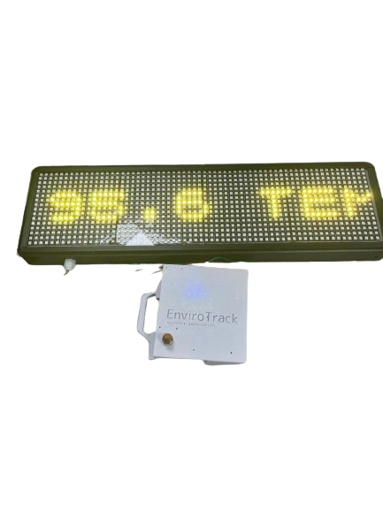
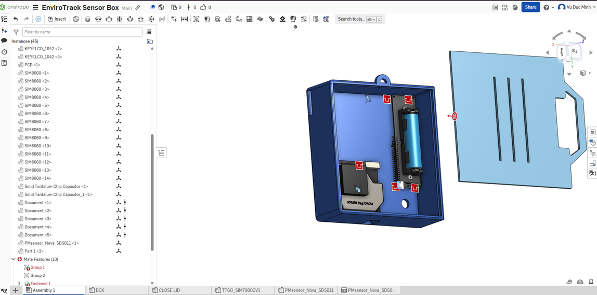

# Hardware

This document describes the components, wiring, power supply and enclosure of the EnviroTrack station.

<p align="center">
  
</p>

## Bill of materials

| Qty | Component | Description |
|---|---|---|
| 1 | LILYGO TTGO T-A7670G | ESP32 module with SIMCom A7670G LTE Cat-1 modem; requires a nano-SIM with mobile data |
| 1 | Nova Fitness SDS011 | laser scattering PM2.5/PM10 sensor with built-in fan |
| 1 | SHT30 breakout board | digital temperature and humidity sensor |
| 4 | WS2812B 16x16 RGB LED panel | daisy-chained into a 64x16 matrix (1024 LEDs) |
| 1 | 18650 Li-ion cell | main battery |
| 1 | Solar panel | charging and off-grid operation |
| 1 | 3D-printed enclosure | box and lid, recycled PLA |
| 1 | 20x4 I2C LCD with PCF8574 backpack (optional) | local status screen |

## Block diagram

```
                 UART (9600 baud)
  SDS011  <------------------------->  +-------------------+
                                       |                   |    LTE     ThingSpeak
                 I2C                   |  LILYGO T-A7670G  | ---------> cloud
  SHT30   <------------------------->  |  (ESP32 + A7670G) |
                                       |                   |
                 GPIO32 (data)         +-------------------+
  LED matrix  <-----------------------------------+
  (4x WS2812B 16x16)
```

## Pin connections

| Signal | ESP32 pin | Defined in |
|---|---|---|
| SDS011 TX -> ESP32 RX (UART2) | GPIO13 | [`loop_sds011.py` L29](../firmware/loop_sds011.py#L29) |
| ESP32 TX (UART2) -> SDS011 RX | GPIO14 | [`loop_sds011.py` L29](../firmware/loop_sds011.py#L29) |
| LED matrix DIN | GPIO32 | [`ledpm25.py` L22](../firmware/ledpm25.py#L22) |
| LCD SCL / SDA (SoftI2C, 10 kHz, address 0x27) | GPIO22 / GPIO21 | [`loop_sds011.py` L214](../firmware/loop_sds011.py#L214) |
| SHT30 (I2C) | defined in `sht30.py` | see [firmware requirements](../firmware/README.md#requirements) |
| Supply voltage sense (`vpower`) | GPIO36 (ADC) | [`loop_sds011.py` L105](../firmware/loop_sds011.py#L105) |
| Battery voltage sense (`vbat`) | GPIO35 (ADC) | [`loop_sds011.py` L108](../firmware/loop_sds011.py#L108) |
| LTE modem | on-board | handled by `sim7600.py` |

The supply and battery voltages are measured through the board's on-board voltage dividers, so the firmware multiplies the ADC reading by 2.

**Note:** the board's microSD slot uses GPIO2, GPIO13, GPIO14 and GPIO15. Because GPIO13 and GPIO14 are used for the SDS011, SD card logging is disabled in this build (`mount_sd()` is commented out in `loop_sds011.py`).

## Sensors

**Nova Fitness SDS011**

| Parameter | Value |
|---|---|
| Measured values | PM2.5, PM10 |
| Range | 0.0-999.9 µg/m³ |
| Supply | 5 V |
| Current | 70 mA ± 10 mA working, < 4 mA in sleep mode |
| Interface | UART, 3.3 V logic, 9600 baud |
| Laser service life | up to 8000 hours |

The firmware keeps the sensor asleep between measurements and wakes it for about 5 seconds per cycle, which extends the laser's service life.

**SHT30**

Digital temperature and humidity sensor on the I2C bus. It is read once per cycle right after the SDS011.

## LED matrix

The display consists of four 16x16 WS2812B panels chained into one 64x16 matrix with a single data line on GPIO32. The LEDs are wired column by column in a zigzag: column 0 runs top to bottom (LEDs 0-15), column 1 bottom to top (LEDs 16-31), and so on. The driver converts (x, y) coordinates to the LED index accordingly, see [formulas](../docs/formulas.md#5-led-matrix-addressing).

The panels need a 5 V supply. Text is drawn in yellow, `(255, 255, 0)`.

## Power

The station runs from an 18650 Li-ion cell charged by a solar panel. Estimated consumption of the main loads (calculations in [docs/formulas.md](../docs/formulas.md#7-led-matrix-current)):

| Load | Estimated current |
|---|---|
| SDS011, fan running | 70 mA |
| SDS011, sleep | < 4 mA |
| LED matrix, scrolling text at full brightness | about 3.2 A average, 4.4 A peak (at 5 V) |
| LED matrix, all LEDs off | about 0.5-1 A |

The LED matrix is the largest load. Its current scales roughly with the colour value, so lowering the brightness in `ledpm25.py` reduces consumption proportionally.

## Enclosure

The enclosure was designed in Onshape and 3D-printed from recycled PLA.

CAD model: [EnviroTrack Sensor Box on Onshape](https://cad.onshape.com/documents/0a626a447117ea0ad3f21979/w/347160ab35c9118ccb145934/e/014f66a905b2dad819e251cb)



- Two printed parts: the box and a removable lid
- Three slots and a handle cut-out on the lid
- Hanging loop on top of the box
- Models of the SDS011, a LILYGO board and an 18650 holder (Keystone 1042) are included in the assembly to check the fit
