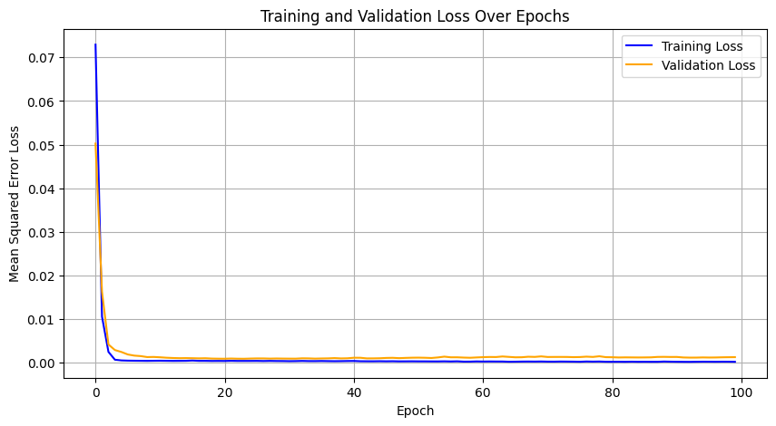
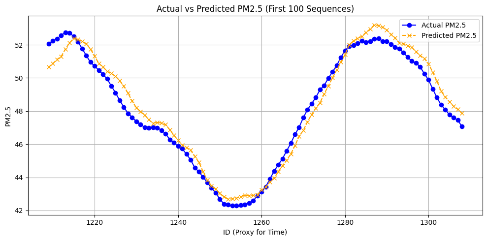
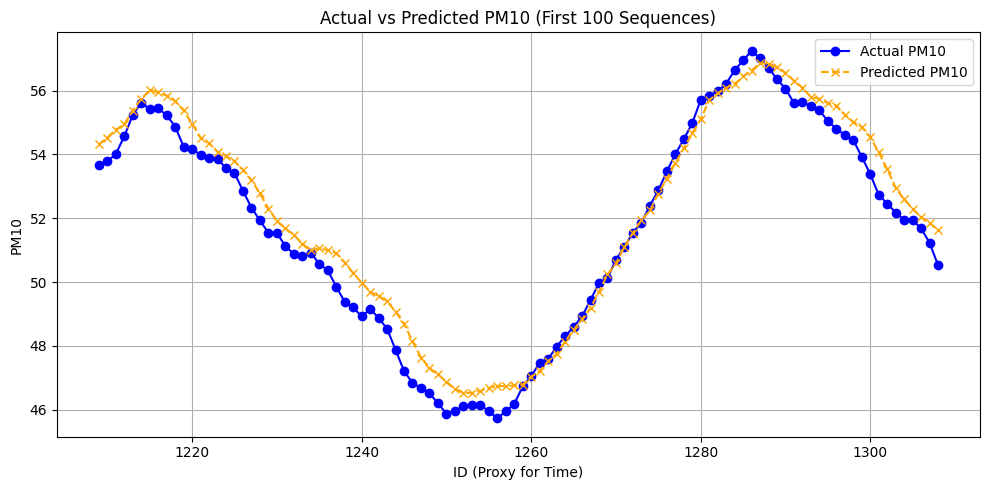
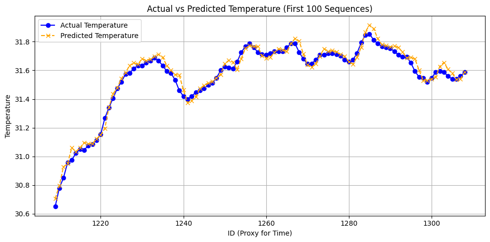
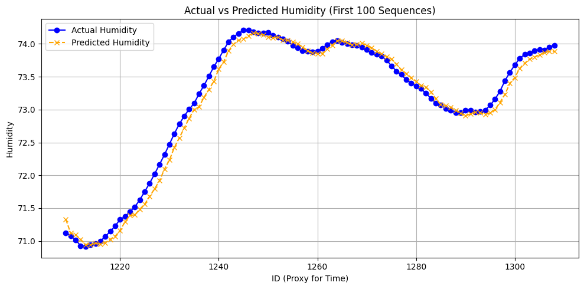

# AI Forecasting Model

A 1D convolutional neural network (CNN) that forecasts PM2.5, PM10, temperature and humidity from recent sensor readings.

- Notebook: [Air_quality_prediction.ipynb](Air_quality_prediction.ipynb)
- Colab: [open in Google Colab](https://colab.research.google.com/drive/1Hv9hX5pBAijUH8XXvNGJn_4dMrWGwrMp)
- Framework: TensorFlow / Keras, scikit-learn, pandas

## Overview

| | |
|---|---|
| Input | 3 consecutive time steps x 4 variables (30-minute rolling averages) |
| Output | the 4 variables at the next time step |
| Model | Conv1D -> MaxPooling1D -> Flatten -> Dense -> Dense |
| Parameters | 358 |
| Loss | mean squared error |

## Dataset

The dataset consists of readings collected by the EnviroTrack station and exported from the ThingSpeak channel to `data.xlsx` (sheet `in`).

| Column | Description |
|---|---|
| `Timestamp` | time of the reading |
| `ID` | ThingSpeak entry ID, used as the time index |
| `pm2.5` | PM2.5 (µg/m³) |
| `pm 10` | PM10 (µg/m³) |
| `temp` | temperature (°C) |
| `humi` | relative humidity (%) |

Readings are about 2 minutes apart, and the dataset contains roughly 2,000 rows (about three days of measurements).

## Preprocessing

**1. Rolling average.** Each variable is smoothed with a 15-sample rolling mean, which corresponds to about 30 minutes:

```math
\bar{x}_t = \frac{1}{m_t} \sum_{k=0}^{m_t - 1} x_{t-k}, \qquad m_t = \min(15,\ t + 1)
```

**2. Normalization.** Each variable is scaled to [0, 1] with min-max scaling (`MinMaxScaler`); predictions are converted back with the inverse transform:

```math
x' = \frac{x - x_{\min}}{x_{\max} - x_{\min}}
```

**3. Sequences.** With s_t the normalized vector [PM2.5, PM10, temperature, humidity] at step t, each training sample uses three consecutive steps as input and the following step as the target:

```math
X_i = \begin{bmatrix} s_i \\ s_{i+1} \\ s_{i+2} \end{bmatrix} \in \mathbb{R}^{3 \times 4}, \qquad y_i = s_{i+3} \in \mathbb{R}^{4}
```

## Model architecture

From the notebook (`sequence_length = 3`):

```python
model = Sequential([
    Conv1D(filters=16, kernel_size=2, activation='relu', input_shape=(sequence_length, 4)),
    MaxPooling1D(pool_size=2),
    Flatten(),
    Dense(10, activation='relu'),
    Dense(4)  # Output: pm2.5, pm10, temp, humi
])

model.compile(optimizer=Adam(learning_rate=0.01), loss='mse')
```

| Layer | Output shape | Parameters |
|---|---|---|
| Input | 3 x 4 | 0 |
| Conv1D (16 filters, kernel size 2, ReLU) | 2 x 16 | 144 |
| MaxPooling1D (pool size 2) | 1 x 16 | 0 |
| Flatten | 16 | 0 |
| Dense (10 units, ReLU) | 10 | 170 |
| Dense (4 units, linear) | 4 | 44 |
| **Total** | | **358** |

Parameter counts are derived in [docs/formulas.md](../docs/formulas.md#10-cnn-layer-shapes-and-parameters).

## Training

| Setting | Value |
|---|---|
| Optimizer | Adam, learning rate 0.01 |
| Loss | mean squared error (MSE) |
| Epochs | 100 |
| Batch size | 32 |
| Validation | last 20% of the sequences (`validation_split=0.2`) |

## Results



Both training and validation loss drop sharply in the first epochs and remain stable afterwards.

| Metric (normalized data) | Training | Validation |
|---|---|---|
| MSE at epoch 100 | 1.75 x 10⁻⁴ | 1.2 x 10⁻³ |
| RMSE | 0.013 | 0.035 |

Actual and predicted values for the first 100 sequences (training portion of the dataset):

| | |
|---|---|
|  |  |
|  |  |

Forecast for the next window after the end of the dataset, as printed by the notebook:

| Variable | Predicted value |
|---|---|
| PM2.5 | 39.09 µg/m³ |
| PM10 | 43.07 µg/m³ |
| Temperature | 30.87 °C |
| Humidity | 76.26 % |

## Usage

1. Open the notebook in Google Colab.
2. Upload `data.xlsx` with a sheet named `in` and the columns listed above.
3. Run all cells. The notebook trains the model, plots the loss and predictions, and prints the forecast for the next window.

To create `data.xlsx` from the public channel, download `https://api.thingspeak.com/channels/2977228/feeds.csv?results=8000`, rename the columns `created_at, entry_id, field1, field2, field3, field4` to `Timestamp, ID, pm2.5, pm 10, temp, humi`, and save it as an Excel file with a sheet named `in`.

## Future improvements

- Forecast further ahead using non-overlapping 30-minute windows
- Compare against a persistence baseline and report errors in µg/m³ on the validation set
- Fit the scaler on the training portion only
- Train on a longer dataset and add weather and traffic data as inputs
